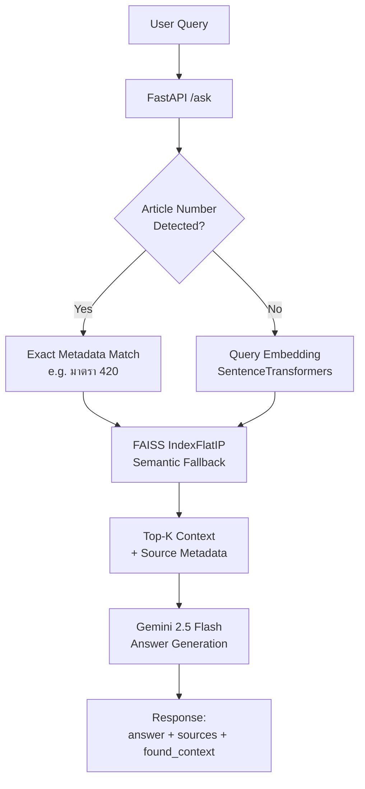
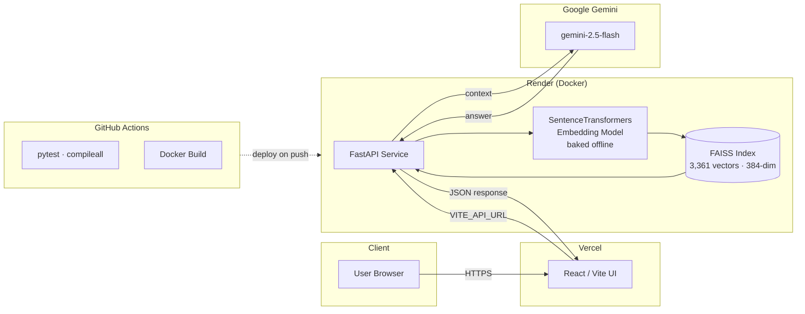

# Thai Legal RAG

<div align="center">

[](https://thai-legal-rag.vercel.app)
[](https://thai-legal-rag.onrender.com/docs)
[](https://github.com/ThawatchaiDrakeao/Thai-Legal-RAG-Showcase)

<br/>


</div>

> ⚠️ Update/verify: swap in your real `LICENSE` file and badge (e.g. MIT) once added — no license badge is included here since none was confirmed in the repo.

**A Thai legal-domain Retrieval-Augmented Generation (RAG) system** that retrieves relevant legal passages from a structured corpus and uses Google Gemini to generate grounded, source-cited answers. Built to demonstrate production-oriented AI engineering: hybrid retrieval, deterministic deployment, and evidence-based debugging — not just a notebook demo.

---

### 🌐 Quick Links & Live Application
- 🚀 **Live Web Application:** [**thai-legal-rag.vercel.app**](https://thai-legal-rag.vercel.app)
- ⚡ **Backend API Service:** [**thai-legal-rag.onrender.com**](https://thai-legal-rag.onrender.com)
- 📖 **Interactive Swagger API Docs:** [**thai-legal-rag.onrender.com/docs**](https://thai-legal-rag.onrender.com/docs)
- 📂 **Showcase Repository:** [**github.com/ThawatchaiDrakeao/Thai-Legal-RAG-Showcase**](https://github.com/ThawatchaiDrakeao/Thai-Legal-RAG-Showcase)

> This is an educational/portfolio project, not legal advice.

---

## Demo

> 💡 **Try it live without any installation:** Click [**thai-legal-rag.vercel.app**](https://thai-legal-rag.vercel.app) to test questions like:
> - `มาตรา 420 มีความรับผิดอย่างไร` (Civil Code - Tort Liability)
> - `ลักทรัพย์เวลากลางคืนมีโทษอย่างไร` (Criminal Code - Nighttime Theft)
> - `มาตรา 288 คืออะไร` (Multi-source Article Retrieval)

<!--
📸 SCREENSHOT CHECKLIST — capture these and drop them in a /docs/screenshots or /assets folder,
then replace the placeholders below with real image links, e.g.:


1. Landing/chat UI empty state — shows clean design, Thai-language input placeholder
2. A submitted query in Thai (e.g. "มาตรา 420 มีความรับผิดอย่างไร") with the answer rendered
3. The sources panel expanded — showing source_file, page_number, and score (proves retrieval, not just LLM guessing)
4. (Optional) Browser DevTools Network tab showing the POST /ask request/response JSON — great for technical reviewers
5. (Optional) A short screen-recording GIF of the full flow: type question → get answer → see sources
-->

| Query UI | Answer + Sources |
|---|---|
| _screenshot placeholder_ | _screenshot placeholder_ |

---

## Table of Contents

- [Problem](#problem)
- [Architecture](#architecture)
- [Engineering Highlights](#engineering-highlights)
- [Tech Stack](#tech-stack)
- [RAG Pipeline](#rag-pipeline)
- [Embedding Model](#embedding-model)
- [LLM](#llm)
- [API](#api)
- [Verification](#verification)
- [Known Limitations](#known-limitations)
- [Local Development](#local-development)
- [Testing](#testing)
- [Continuous Integration](#continuous-integration)
- [Project Structure](#project-structure)
- [License / Disclaimer](#license--disclaimer)

---

## Problem

Thai legal information is difficult to query naturally across multiple source documents and legal domains. This project explores a **retrieval-first** approach: retrieve relevant legal passages before asking an LLM to formulate an answer, so responses stay grounded in real source text instead of hallucinated legal claims.

---

## Architecture

### Request Flow



### System / Deployment Architecture



**Design notes:**
- Retrieval and generation are decoupled: FAISS/retrieval logic selects context deterministically before Gemini ever sees the query, keeping the LLM stage swappable.
- Exact-match short-circuits semantic search when an explicit article number (e.g. `มาตรา 420`) is detected, reducing latency and improving precision on direct lookups.
- The embedding model is baked into the Docker image (`HF_HUB_OFFLINE=1`, `local_files_only=True`) to avoid runtime downloads and reduce cold-start memory spikes on Render's free tier.
- CI (GitHub Actions) gates every push with `pytest` and `compileall` before the Docker image reaches Render.

---

## Engineering Highlights

- 🇹🇭 Thai-language legal RAG with source-aware, cited responses
- 🔀 Hybrid retrieval: exact article-number matching + semantic fallback
- 🧠 FAISS vector search (`IndexFlatIP`) with SentenceTransformers embeddings
- ⚡ FastAPI with request validation and quota protection
- 🐳 CPU-only PyTorch dependency pinning for deterministic Docker builds
- 📦 Model baking + offline runtime loading (no cold-start downloads)
- 🔁 Reproducible ingestion and FAISS index generation pipeline
- ✅ Production smoke verification and article-level regression checks
- 🔍 Evidence-based debugging — memory diagnosis via `resource.getrusage()`, not guesswork

---

## Tech Stack

| Layer | Technology |
|---|---|
| Backend API | FastAPI (Python) |
| Retrieval | FAISS (`IndexFlatIP`, cosine similarity) |
| Embeddings | SentenceTransformers — `alphaedge-ai/multilingual-e5-small-tha-16384` |
| LLM | Google Gemini (`gemini-2.5-flash`) via `google-genai` SDK |
| Frontend | React + Vite |
| Containerization | Docker (CPU-only PyTorch, offline model loading) |
| CI/CD | GitHub Actions (`pytest`, `compileall`) |
| Hosting | Render (backend) · Vercel (frontend) |
| Corpus | PyThaiNLP Thai-law dataset, Civil & Commercial Code snapshot |

---

## RAG Pipeline

1. Ingest legal source files.
2. Chunk the documents and preserve source metadata.
3. Generate normalized embeddings.
4. Build a FAISS `IndexFlatIP` index.
5. Detect explicit article numbers and perform exact metadata matching when present.
6. Use semantic retrieval to fill the result set.
7. Pass the selected context to Gemini.
8. Return the answer together with source text, source file, page, and score fields.

The verified corpus contains **3,361 vectors** in a **384-dimensional** FAISS index, built from the Civil and Commercial Code snapshot, the PyThaiNLP Thai-law dataset, and a small sample law source. The structured PyThaiNLP dataset is preferred over the problematic penal-code OCR PDF.

### Legal Sources

| Source | Role |
|---|---|
| `civil_commercial_code_snapshot.pdf` | Primary Civil and Commercial Code source |
| `penal_code_pythainlp.csv` | Structured Thai-law records, Articles 1–398 |
| `sample_law.txt` | Small sample source for ingestion pipeline testing |
| `penal_code_snapshot.pdf` | ❌ Excluded — font encoding produced unreliable OCR/article text |

---

## Embedding Model

The production embedding configuration:

```text
alphaedge-ai/multilingual-e5-small-tha-16384
```

Loaded through SentenceTransformers `6.0.1` for Thai/multilingual query and document embeddings. The verified Docker image bakes the model into `/app/.sentence_transformers_cache` and uses local/offline loading at runtime.

> No benchmark superiority claim is made here — the documented metrics are the verified index dimensions and vector count.

---

## LLM

The RAG pipeline uses Google Gemini through the `google-genai` SDK:

```text
gemini-2.5-flash
```

The prompt instructs Gemini to answer strictly from the retrieved legal context and identify the available source information.

---

## API

### `GET /`

```json
{
  "service": "Thai Legal RAG API",
  "status": "ok"
}
```

### `GET /health`

Returns service status and the in-process daily/minute request counters. Intentionally lightweight — does not force lazy resource loading.

### `POST /ask`

**Request:**

```json
{
  "question": "มาตรา 420 มีความรับผิดอย่างไร"
}
```

`question` is required, 1–2,000 characters.

**Response:**

```json
{
  "answer": "...",
  "sources": [
    {
      "text": "...",
      "source_file": "civil_commercial_code_snapshot.pdf",
      "page_number": 75,
      "score": 1.0
    }
  ],
  "found_context": true
}
```

> Demo service limits: **4 requests/minute**, **15 requests/day**.

---

## Verification

| Check | Result |
|---|---|
| Docker build | ✅ PASS |
| CPU-only PyTorch | `2.13.0+cpu` |
| `torch.cuda.is_available()` | `False` |
| SentenceTransformers | `6.0.1` |
| FAISS vectors | 3,361 |
| FAISS dimension | 384 |
| `python -m compileall src` | ✅ PASS |
| `pytest` | ✅ 6 passed |
| Production `GET /` | ✅ HTTP 200 |
| Production `GET /health` | ✅ HTTP 200, `status: ok` |
| Production `POST /ask` | ✅ HTTP 200 (smoke verification) |
| Production Article 420 | ✅ PASS |
| Production Article 288 | ⚠️ PASS with known civil/criminal collision |

> Production smoke verification is successful for the checks above. This is **not** a claim of 24/7 reliability, long-term stability, or production-scale performance.

### Example Regression Checks

**Article 420** — `มาตรา 420 มีความรับผิดอย่างไร`
HTTP 200 · `found_context: true` · Civil and Commercial Code source retrieved, page 75, score 1.0. Answer correctly described Article 420 tort liability. **Verified end-to-end**: Vercel frontend → Render `/ask` → FAISS retrieval → Gemini → Vercel UI.

**Article 288** — `มาตรา 288 คืออะไร` / `มาตรา 288 มีโทษอย่างไร`
HTTP 200 · `found_context: true` · Both civil (`page 55`, preferential right in real-estate sale) and criminal (`pythainlp_thai_law`, killing another person) contexts surfaced at score 1.0 — demonstrating the known article-number collision documented below.

---

## Known Limitations

1. **Article 288 civil/criminal collision** — the same article number exists in both corpora, which can create retrieval ambiguity.
2. Render memory limit and OOM behavior have not been independently verified.
3. Render Hugging Face runtime-download behavior could not be verified (production logs unavailable).
4. Long-term production stability and soak testing have not been performed.
5. The corpus is limited and should not be treated as a complete representation of Thai law.
6. Some scanned legal PDFs have unreliable font encoding; the affected penal-code OCR source is excluded in favor of structured text.
7. Gemini free-tier quota can produce HTTP 429 responses.

### Future Quality Backlog

- **Article-number disambiguation:** stronger legal-source classification, metadata filtering, or reranking to resolve collisions like Article 288.
- **Reranker v2:** experimental cross-encoder reranking pass, currently in validation against a legal benchmark, held pending further testing before production integration.
- Potential additions to further close skill-signal gaps: LangChain orchestration, PostgreSQL for structured metadata, Azure deployment target.

---

## Local Development

**1. Create a virtual environment**

```bash
python -m venv venv
```

**2. Activate and install dependencies** (Windows PowerShell)

```powershell
.\venv\Scripts\Activate.ps1
pip install -r requirements.txt
```

**3. Configure environment variables**

Set `GOOGLE_API_KEY` or `GEMINI_API_KEY` in `.env` (see `.env.example`).

**4. Run the API**

```bash
python -m uvicorn src.api:app --reload
```

API available at `http://127.0.0.1:8000`, interactive docs at `/docs`.

**5. Run with Docker** (verified CPU/offline model path)

```bash
docker build -t thai-legal-rag .
docker run --env-file .env -p 8000:8000 thai-legal-rag
```

---

## Testing

```bash
python -m compileall src
pytest
```

Verified result: **6 passed tests**.

---

## Continuous Integration

`.github/workflows/tests.yml` runs `pytest` and `compileall` on every push, gating the Docker image before it reaches Render.

---

## Project Structure

```text
thai-legal-rag/
├── .github/workflows/tests.yml
├── data/
│   ├── raw/
│   └── processed/
├── frontend/
├── scripts/
├── src/
│   ├── api.py
│   ├── build_embeddings.py
│   ├── chunk_documents.py
│   ├── ingest_csv.py
│   ├── ingest_pdf.py
│   ├── query.py
│   └── rag_pipeline.py
├── tests/
├── Dockerfile
├── requirements.txt
├── requirements-docker.txt
├── PROJECT_SUMMARY.md
└── README.md
```

---

## License / Disclaimer

This project is provided for **educational and demonstration purposes only**. Generated answers may be incomplete or incorrect. Do not use this system as a substitute for professional legal advice or official legal sources.
